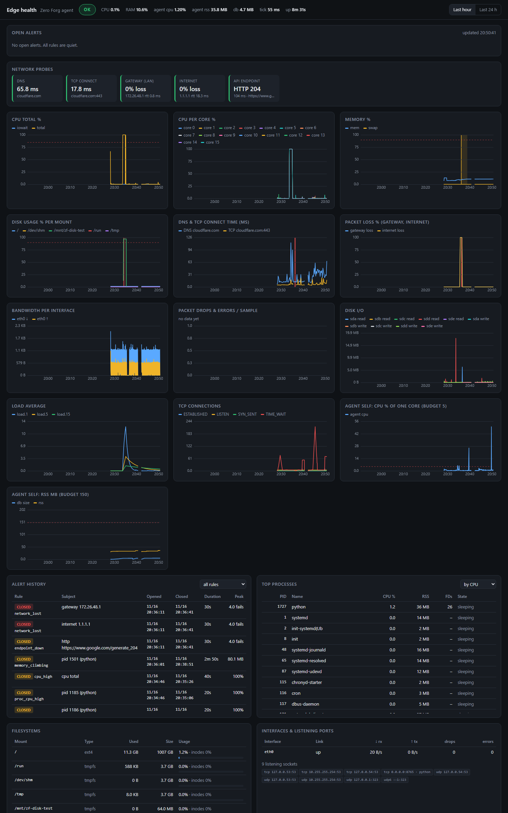
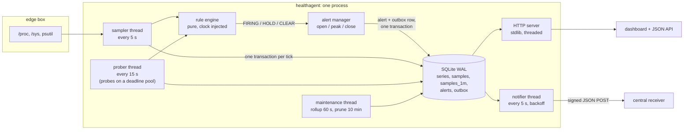

# Zero Forg edge health agent

One Python process that watches an unattended edge box and notices first when it
fills its disk, leaks memory, loses a process or loses its uplink.

It samples the machine every 5 s, probes the network every 15 s, keeps 7 days of
history in SQLite, raises alerts on fixed rules, and serves everything over an HTTP
API and a single-page dashboard. The only dependency is `psutil`.



**Measured on Linux** (Ubuntu, kernel 6.6, 16 cores, 338 processes): **0.9 % of one
core idle, 1.35 % with the dashboard open, 34 MB RSS**. The budget is 5 % and 150 MB.

**97 tests** pin down every rule from the brief with a fake clock. They pass on Linux
and Windows, and CI runs them on Python 3.11–3.13 together with lint and a smoke test
of the real agent.

---

## Contents

- [Quick start](#quick-start)
- [What the brief asked for, and where it lives](#what-the-brief-asked-for-and-where-it-lives)
- [Verified results](#verified-results)
- [Architecture](#architecture)
- [Alert rules](#alert-rules)
- [Alerts off the box](#alerts-off-the-box)
- [Tests](#tests)
- [HTTP API](#http-api)
- [Storage and retention](#storage-and-retention)
- [Staying inside the budget](#staying-inside-the-budget)
- [Design decisions](#design-decisions)
- [Configuration](#configuration)
- [Running on an edge box](#running-on-an-edge-box)
- [Project layout](#project-layout)
- [Limitations and next steps](#limitations-and-next-steps)

---

## Quick start

Requires Linux and Python 3.11+. It also runs on Windows or macOS for development,
with fewer metrics.

```bash
python3 -m venv .venv
.venv/bin/pip install -r requirements.txt
.venv/bin/python -m healthagent -c config.toml
# open http://127.0.0.1:8765/
```

```bash
curl -s localhost:8765/health | python3 -m json.tool
curl -s 'localhost:8765/alerts?open=true'
curl -s 'localhost:8765/metrics?name=cpu.total&since=15m'
curl -s 'localhost:8765/processes?sort=cpu&limit=10'
```

To run the five demo scenarios from the brief, follow [docs/DEMO.md](docs/DEMO.md).

---

## What the brief asked for, and where it lives

| Brief | Implementation |
|---|---|
| **Collect every 5 s:** CPU per core, RAM, swap, disk per mount, disk I/O, uptime, load | [`collectors/system.py`](healthagent/collectors/system.py). Also iowait, steal and inode usage |
| Upload/download bandwidth, drops and errors per interface, TCP connections, listening ports | [`collectors/network.py`](healthagent/collectors/network.py). Sockets are parsed from `/proc/net/{tcp,tcp6,udp,udp6}`, and listening ports are mapped to their owning process |
| CPU and RAM per process, open FDs | [`collectors/processes.py`](healthagent/collectors/processes.py) |
| Rates from counter deltas, handle counter resets | [`rates.py`](healthagent/rates.py): when a counter goes backwards, that interval is dropped and the baseline reseeded |
| **Watch processes:** high CPU/RAM, zombies, watch-list exits, climbing memory | `proc_cpu_high`, `proc_mem_high`, `zombie`, `process_died`, `memory_climbing` in [`rules.py`](healthagent/rules.py) |
| **Probe every 15 s:** DNS time, TCP connect time, packet loss to gateway and internet, gateway reachable, API endpoint status and latency | [`probes.py`](healthagent/probes.py) |
| Every probe has a timeout; a hung DNS lookup never stalls the sampler | Probes run on their own thread, each call has a hard deadline, and a call that is still hung is not started again ([`deadline.py`](healthagent/deadline.py)) |
| **API:** `/health`, `/metrics?name=&since=`, `/alerts?open=true`, `/processes?sort=cpu` | [`api.py`](healthagent/api.py), plus `/system` |
| **Dashboard:** last hour and last 24 h, open and closed alerts, health badge | [`static/index.html`](healthagent/static/index.html): one file, no CDN |
| **Alert rules** in SQLite, open once, close once, store rule, subject, opened, closed, peak | [`rules.py`](healthagent/rules.py), [`alerts.py`](healthagent/alerts.py), [`storage.py`](healthagent/storage.py) |
| Under 5 % of one core and 150 MB; 7 days of history without growing forever | [Budget](#staying-inside-the-budget), [Retention](#storage-and-retention) |
| **Show it working** | [docs/DEMO.md](docs/DEMO.md): a timed runbook and scripts in [`demo/`](demo) |

Beyond the brief, because a box nobody can see needs them:

| Addition | Why |
|---|---|
| [Alerts leave the box](#alerts-off-the-box) through a webhook with a SQLite outbox | An alert that only lives on the box is useless while the uplink is down. The outbox holds notifications until the receiver can be reached |
| `required = true` watch entries | Catches the camera pipeline that never came back after a reboot, not only one that exits while the agent watches |
| Inode alerts, guarded `statvfs` | Millions of small files fill a disk with bytes to spare; a dead NFS mount must not freeze the sampler |
| The agent watches itself | `/health` goes `critical` if the sampler stalls, and the dashboard charts the agent's CPU and RSS against the budget |

---

## Verified results

Every scenario was run end to end on Linux (WSL2 Ubuntu) against the real agent, with
the alert read back from `/alerts`. Times are relative to the moment the script
started.

| # | Scenario | Script | Opened | Closed | Stored subject and peak |
|---|---|---|---|---|---|
| 1 | Busy loop on all 16 cores for 80 s | `demo/cpu_burn.py` | **+69.7 s** (never before +60) | +99.7 s | `cpu total`, peak 100 % |
| 2a | Allocate RAM to 93 %, hold 25 s | `demo/mem_pressure.py` | +9.8 s (allocation took 8 s) | +34.8 s, right after release | `ram`, peak 93.4 % |
| 2b | Leak 8 MB every 10 s | `demo/leak.py` | 104 s after the leak started | 3 samples after growth stopped | `pid 560 (python)`, +80 MB |
| 3 | Fill a 64 MB tmpfs to 97 % | `demo/fill_disk.sh` | next sample (5 s) | next sample after cleanup | `/mnt/zf-disk-test`, peak 96.9 % |
| 4 | `kill -9` the watched process | `demo/watched_service.py` | 2.7 s after the kill | when it was restarted | `camera-sim pid 589 (python3)` |
| 5 | Interface down for 75 s | `demo/net_toggle.sh` | +33.9 s (3rd failed round) | +78.9 s (first good round) | `gateway 172.26.48.1`, `internet 1.1.1.1`, peak 5 failures |
| + | Zombie child for 45 s | `demo/zombie.py` | after 35 s in state Z | when reaped | `pid 998 (python)` |
| + | Required process never started | `config.demo.toml` | after the 60 s grace | when it started | `camera-sim (not running)` |
| + | Webhook receiver down during a kill -9 and restart | `demo/webhook_receiver.py` | both events queued (outbox 2) | delivered in order 50 s and 35 s late, right after the receiver returned | |

Other checks:

- **Hung DNS.** With `getaddrinfo` replaced by a 40 s sleep, the first round reported
  `timeout after 2s` after 2.0 s. Later rounds reported `previous attempt still hung`
  in 0.4 s. The gateway and internet probes kept working, and the thread count stayed
  flat.
- **Retention.** Seeding 9 days of history for 100 series and running one maintenance
  pass left raw data at exactly 24 h and rollups at exactly 7 days. The database
  settled at 84 MB, and the pass took 0.6 s.
- **Rule edges** are covered by the [test suite](#tests). Examples: CPU opens at 60 s,
  not 55; 84/86 % alternating neither closes nor reopens an alert; memory climbing
  accepts 9 of 10 rises but not 8; a restarted agent adopts its open alerts instead of
  duplicating them.
- **API hygiene.** A bad `since` returns 400. `POST` returns 405. Responses over 1 KB
  are gzipped (the dashboard is 9 KB on the wire).

Why `cpu_high` opened at +69.7 s instead of +60 s: the 60 s window starts at the
first 5-second sample whose average is above 85 %. The sample that overlaps the
moment load starts is part idle, so it averages below 85 %. Counting from that
partial sample would let the alert fire before the CPU had really been above 85 % for
60 s. The rule is built to err late, never early, so in practice it opens 60–70 s
after load starts.

---

## Architecture



- **Each loop has its own thread.** Nothing the prober or the notifier does (DNS, TCP,
  ping, HTTPS) can delay a sample. Each loop is scheduled on the monotonic clock against a fixed
  grid, so ticks do not drift. An overrun skips ticks instead of bunching them up,
  and is counted in `/health`.
- **Rules are pure.** A rule gets a sample (or probe round) and `now`, and returns a
  signal for every subject it tracks. It never reads the clock or the database. Rules
  can therefore be tested by replaying data, and a recorded incident always produces
  the same alerts.
- **The alert manager owns persistence.** It turns signals into alert rows and closes
  alerts whose subject disappeared (process exited, mount removed).

---

## Alert rules

| Rule | Opens | Closes | Severity |
|---|---|---|---|
| `cpu_high` | Total CPU **> 85 %** on every sample for **≥ 60 s**. A missing sample counts as a break | < 80 % for 10 s | warn |
| `ram_high` | RAM used **> 90 %** (`total − available`) | < 85 % | critical |
| `disk_high` | Any real mounted filesystem **> 90 %** (subject = mount) | < 85 % | critical |
| `disk_inodes_high` | Inodes > 90 % on a mount | < 85 % | critical |
| `network_lost` | Gateway or internet ping fails **3 rounds in a row** (subject = host) | First good round | critical |
| `endpoint_down` | Configured HTTP endpoint errors or returns 5xx 3 rounds in a row | First good response | warn |
| `memory_climbing` | RSS rose in **≥ 9 of the last 10** one-minute samples **and** by **≥ 50 MB** (subject = PID) | Process exits, or no growth over the last 3 samples | warn |
| `process_died` | A watch-list process that was running disappears or turns zombie (subject = name + PID). With `required = true`, also when no instance has run for 60 s (subject = `name (not running)`) | A new instance of the same watch entry starts | critical |
| `zombie` | A process stays in state Z for **> 30 s** (subject = PID) | Reaped | warn |
| `proc_cpu_high` | One process > 90 % of one core for 60 s | < 70 % for 10 s | warn |
| `proc_mem_high` | One process RSS > 30 % of RAM for 30 s | < 25 % | warn |

`/health` returns the worst severity among open alerts: `ok`, `warn` or `critical`.
It also reports `critical` when the sampler itself has not run for 3 intervals, so a
wedged agent cannot report itself healthy.

### How "opens once, no flapping" is guaranteed

1. **Three-state signals.** Each rule returns FIRING, HOLD or CLEAR for each subject.
   HOLD covers the hysteresis band (80–85 % for CPU) and conditions that are still
   building up (CPU above 85 % for only 30 s). HOLD keeps an open alert open and never
   opens a new one.
2. **Hysteresis.** Opening and closing use different thresholds, so a value hovering
   at 85 % produces exactly one alert.
3. **Durations reset on a break.** A single sample below the threshold restarts the
   60 s window, and so does a missed sample: "without a break" means the agent saw
   the value the whole time.
4. **The database enforces it.** A partial unique index allows at most one open alert
   per `(rule, subject)`:
   `CREATE UNIQUE INDEX alerts_one_open ON alerts (rule, key) WHERE closed_at IS NULL`.
5. **Restarts do not duplicate or drop alerts.** On startup, alerts that are still open
   are handed back to their rules ("adopted"). A CPU alert that was open before a
   restart stays open until CPU is actually below 80 %. It does not reopen as a new
   row, and it does not close just because the rule's in-memory state was lost.

### Numbers I chose, and why

- **Memory climbing** keeps the brief's 9 of 10 rises and 50 MB. 50 MB is well above
  normal allocator and page-cache noise for long-running processes. It closes after
  **3 flat samples**, so a leak that pauses for one sample does not close and reopen.
  Processes are keyed by `(pid, start time)`, so a reused PID never inherits another
  process's history.
- **RAM** counts `total − available`, not `total − free`. Page cache the kernel can
  drop is not memory pressure.
- **Disk** skips pseudo filesystems (proc, cgroup, overlay, ...), `squashfs` snaps
  (always 100 % full by design) and host drives shared into a VM (9p). It includes
  tmpfs, since a full `/run` or `/dev/shm` breaks things too.
- **Network lost** treats only 100 % loss in a round as a failure. Partial loss is
  recorded as `probe.loss_pct` and charted, but it is degraded service, not "lost".
- **Process died** treats each death as its own alert. One restart closes the oldest
  open death for that entry, which handles pools of workers. A process that turns
  zombie counts as dead. For `required` entries, the 60 s grace after agent start
  lets the service come up after a reboot before "not running" becomes an alert.
  While a death alert is open, no second "not running" alert is raised for the
  same outage.

---

## Alerts off the box

The brief's agent raises alerts on the box. But the failures it exists for (disk full,
uplink lost) are exactly the ones where nobody is looking at the box. With
`notify.webhook_url` set, every alert open and close is also POSTed as JSON to a
central receiver.

```toml
[notify]
webhook_url = "https://alerts.example.com/edge"
secret      = "..."   # optional: X-Healthagent-Signature: sha256=<HMAC-SHA256 of the body>
```

```json
{
  "id": "dda2324a8f0c4b2e9d1f6a7b3c5e8d90",
  "event": "alert.opened",
  "source": "edge-box-17",
  "queued_at_iso": "2026-11-16T15:48:40+00:00",
  "alert": { "rule": "process_died", "subject": "camera-sim pid 612 (python3)", "severity": "critical",
             "opened_at_iso": "2026-11-16T15:48:40+00:00", "closed_at_iso": null, "peak_value": 0.0,
             "message": "watched process camera-sim (pid 612, python3) disappeared" }
}
```

How delivery holds up when the network does not:

- **Transactional outbox.** The alert row and its outbox row are written in one SQLite
  transaction. A power cut can never leave an alert without its notification, or the
  reverse.
- **Survives outages and restarts.** Undelivered notifications stay in SQLite and are
  retried with exponential backoff (5 s, doubling to 5 min). When the internet probe
  recovers, the backlog is flushed at once instead of waiting out the backoff.
  Notifications older than `outbox_days` (7) are dropped with a log line; the alerts
  themselves stay in the history.
- **In order, at least once.** The queue is sent oldest first, and a transient failure
  stops the batch, so an `alert.closed` never overtakes its `alert.opened`. Every
  event has a random `id`, sent as `X-Healthagent-Delivery`, so the receiver can drop
  the duplicate that a lost response causes.
- **Poison events do not block the queue.** A 4xx other than 408/429 means the
  receiver will never accept that event, so it is dropped and logged.
- **Visible.** `/health` → `agent.notify` shows pending count, age of the oldest
  pending event, last error and retry time. The dashboard header shows the outbox.

[`demo/webhook_receiver.py`](demo/webhook_receiver.py) is a receiver for the demo. It
verifies signatures, drops duplicates, and with `--fail-for 60` returns 503 for a
minute so you can watch the agent queue and retry.

---

## Tests

```bash
pip install -e ".[dev]"
pytest          # 97 tests, ~6 s
ruff check .
```

| File | What it pins down |
|---|---|
| [`tests/test_rules.py`](tests/test_rules.py) | Every rule in the brief, through the real AlertManager and SQLite with a fake clock. Opens at 60 s and not 55; a dip or a missed sample restarts the window; no flapping in the hysteresis band; 9/10 rises but not 8/10; < 50 MB is not a leak; PID reuse; zombie at > 30 s; kill -9 then restart; worker pools; required entries; restart adoption; the unique index |
| [`tests/test_probes.py`](tests/test_probes.py) | A hung resolver: the first round times out, later rounds return at once, other probes keep working, no thread per round. TCP falls back to the last resolved address; the gateway is remembered when the route disappears |
| [`tests/test_notify.py`](tests/test_notify.py) | Signed, in-order delivery; backoff during an outage; the queue survives a restart; poison events are dropped; delivery ids are unique even after the queue drains |
| [`tests/test_storage.py`](tests/test_storage.py) | Range and bucket queries, prefix filters with escaped `LIKE` wildcards, idempotent rollups, retention bounds, series cleanup, closed-alert expiry |
| [`tests/test_api.py`](tests/test_api.py) | A real agent sampling the real machine behind the real HTTP server: every endpoint, 400/401/404/405, token auth, gzip |
| [`tests/test_rates_config_parsing.py`](tests/test_rates_config_parsing.py) | Counter resets; config typos and bad values rejected at startup; ping output from iputils, BusyBox and Windows (including Windows' "unreachable counts as a reply"); `/proc/net/route`; IPv4/IPv6 from `/proc/net/tcp` |

Writing the tests and re-running the live scenarios found two real bugs, both now
fixed and covered by a test:

- **Rounded timestamps.** A sample timestamp was rounded up, which hid the newest
  point from `until=now` queries.
- **Reused outbox ids.** SQLite reused outbox id 1 once the queue drained, so a
  receiver deduplicating on it dropped a real alert.

---

## HTTP API

All endpoints are `GET` and return JSON. Timestamps are epoch seconds, plus `*_iso`
fields in local time.

| Endpoint | Parameters |
|---|---|
| `GET /health` | – |
| `GET /metrics` | Without `name`, lists every series. `name=cpu.total,mem.percent` (comma list, trailing `*` for a prefix, e.g. `disk.*`), `subject=/`, `since=1h \| 2026-11-16T10:00 \| <epoch>`, `until=`, `step=<seconds>`, `agg=avg\|max\|min` |
| `GET /alerts` | `open=true\|false\|all`, `rule=cpu_high`, `since=24h`, `limit=100` |
| `GET /processes` | `sort=cpu\|mem\|rss\|fds\|threads\|pid\|name`, `limit=50`, `q=<name, cmdline or pid>` |
| `GET /system` | Latest snapshot: every metric, disks, interfaces, listening ports, last probe round, active config |

```jsonc
// GET /health
{
  "status": "critical",
  "problems": [],
  "open_alerts": [{
    "id": 2, "rule": "process_died", "subject": "camera-sim pid 589 (python3)",
    "severity": "critical", "opened_at": 1794840505.7, "opened_at_iso": "2026-11-16T20:18:25+05:30",
    "closed_at": null, "peak_value": 10.0, "duration_s": 10.0,
    "message": "watched process camera-sim (pid 589, python3) disappeared"
  }],
  "summary": { "cpu_pct": 0.4, "mem_pct": 8.1, "disks": { "/": 1.18 },
               "network": { "dns": true, "tcp": true, "gateway": true, "internet": true, "http": true } },
  "agent": { "name": "edge-box-17", "cpu_pct": 0.2, "rss_mb": 31.4, "db_mb": 0.8, "loop_ms": 12.1,
             "last_sample_age_s": 1.3, "stuck_probes": [], "overruns": 0, "errors": 0,
             "notify": { "enabled": true, "pending": 0, "delivered": 4, "last_error": null } }
}
```

```bash
# DNS and TCP latency around an outage, in 1-minute buckets
curl -s 'localhost:8765/metrics?name=probe.dns_ms,probe.tcp_ms&since=30m&step=60'
# Worst CPU per 5 minutes over the last day
curl -s 'localhost:8765/metrics?name=cpu.total&since=24h&step=300&agg=max'
# Everything that closed today
curl -s 'localhost:8765/alerts?open=false&since=24h'
```

**Metric names:** `cpu.total`, `cpu.core{n}`, `cpu.iowait`, `cpu.steal`, `load.{1,5,15}`,
`mem.{percent,used,available}`, `swap.{percent,used}`, `disk.{percent,used,free,inodes_percent}{mount}`,
`diskio.{read_bps,write_bps,read_iops,write_iops,busy_pct}{device}`,
`net.{rx_bps,tx_bps,rx_drops,tx_drops,rx_errors,tx_errors,up}{iface}`,
`tcp.connections{state}`, `tcp.total`, `ports.listening`, `system.uptime`,
`proc.{count,zombies,threads,fds}`, `probe.{dns_ms,tcp_ms,loss_pct,rtt_ms,http_ms,http_status,up}`,
`agent.{cpu_pct,rss_mb,loop_ms,db_mb,threads,stuck_probes}`, `alerts.open`, `notify.pending`.

**Security.** The API is read-only and binds to `127.0.0.1` by default. If you bind it
to the LAN, set `api.token`; requests then need `Authorization: Bearer <token>` (or
`?token=` for the dashboard). The token check runs in constant time. Every SQL query
is parameterized, and the aggregate function is chosen from a whitelist. The
dashboard escapes every string it renders, including process names and cmdlines.

---

## Storage and retention

```
series      (id, name, subject, unit)              one row per metric + subject
samples     (series_id, ts, value)     5 s raw     WITHOUT ROWID, PK (series_id, ts), kept 24 h
samples_1m  (series_id, ts, avg, min, max, n)      WITHOUT ROWID, kept 7 days
alerts      (rule, key, subject, severity, message, opened_at, closed_at, peak_value, last_value, close_reason)
outbox      (id AUTOINCREMENT, uid, event, payload, attempts, last_error)   notifications not yet delivered
```

- **Compact, indexed rows.** The `WITHOUT ROWID` tables are clustered on
  `(series_id, ts)`. A range read for one series is a single index scan (a 24 h query
  takes 1 ms), and there is no second b-tree to store.
- **One transaction per tick** for all ~100 metrics. WAL mode with
  `synchronous=NORMAL`, so HTTP readers never block the writer.
- **Rollups** are built every minute, per series, using the primary key. A watermark
  in `meta` makes them idempotent and lets them catch up after downtime.
- **Pruning** runs every 10 minutes, deleting per series by key in small
  transactions. Series with no data left are also dropped, so the series table cannot
  grow forever either. Freed pages are reused and the WAL is checkpointed, so the
  file plateaus.
- **Queries pick the source.** Ranges inside the raw window use raw data bucketed to
  `step`, so they are always current. Older ranges use the rollups. The last-24-h chart
  is 720 points, not 17,000.

**Size:** about 0.85 MB per series at steady state. A typical box has 60–150 series
(it depends on core, mount and interface count), which comes to 50–130 MB. That figure
is measured with 9 days of seeded history, not estimated.

---

## Staying inside the budget

| Cost | Choice |
|---|---|
| Web framework, ASGI server | None. `http.server.ThreadingHTTPServer`, with gzip for large responses |
| `psutil.net_connections()` walks every `/proc/<pid>/fd` on every call | TCP states and listening sockets are parsed from `/proc/net/tcp*`. The fd walk that maps ports to processes runs at most once a minute |
| Per-process data | One `process_iter` with a fixed attribute list (one `oneshot` per process). Cmdline is read once per process lifetime. Per-process CPU is computed from `cpu_times` deltas |
| Rule cost per process | Threshold rules track only processes near their threshold, so idle processes cost a dictionary lookup |
| Database writes | One batched `executemany` per tick |
| Dashboard polling | Charts load their range once, then fetch only points newer than the last one they hold. Re-sending an hour of every series every 5 s had cost more CPU than sampling the machine |
| Proof | The agent records its own `agent.cpu_pct`, `agent.rss_mb` and `agent.loop_ms` and charts them against the budget lines |

Measured over 60 s windows with 338 processes:

| Load | Agent CPU (% of one core) | RSS |
|---|---|---|
| Idle, nobody watching | 0.87 % | 34 MB |
| Dashboard open, polling every 5 s | 1.35 % | 34 MB |

A full page load (13 charts × 1 h of 5 s points) shows as a single-sample spike on the
agent CPU chart. The first sample after startup is not recorded, since it measures
imports and the first full process scan, not steady-state cost.

---

## Design decisions

**Probes on a deadline pool.** `getaddrinfo` cannot be interrupted from Python, and
neither can `statvfs` on a dead NFS mount. Each such call runs on a worker with a hard
timeout. If the previous call for the same probe is still stuck, a new one is not
started, and the round reports `previous attempt still hung`. A dead resolver
therefore costs one thread, not one thread per round. The disk-usage collector uses
the same guard, so a hung mount cannot stall the sampler.

**Probe details that matter during an outage.**
- When the link drops, the default route disappears with it. The agent keeps pinging
  the last known gateway, so the outage is measured instead of silently skipped.
- TCP connects to the last address DNS resolved. On the dashboard you can then tell
  "DNS is down" apart from "the network is down".
- Failed probes write no latency point, so outages show as gaps in the DNS and TCP
  charts, as the brief asks.

**Counter resets.** A counter that goes backwards (interface re-created, driver
reload, 32-bit wrap) gives a rate of None for that one interval and a fresh baseline.
A missing point is better than a fake spike. Devices that disappear are forgotten, so
memory stays bounded.

**Dashboard with no CDN.** The charts are about 100 lines of canvas code in the page.
During the "network lost" scenario a CDN-hosted chart library may not load, which is
exactly when you need the dashboard. Charts shade each alert's open-to-close window,
draw threshold lines, break lines where data is missing, and show values on hover.

**Standard library over frameworks.** The only third-party dependency is `psutil`,
which is less to install on hundreds of boxes, less memory, and less to patch. TOML
config uses the built-in `tomllib`. Unknown config keys are rejected at startup, so a
typo cannot silently fall back to a default.

**Least privilege.** The agent runs as an unprivileged user. Without root it cannot see
which process owns another user's listening socket, and the dashboard says so instead
of guessing. Root is needed only by the demo scripts (tmpfs mount, network toggle).

---

## Configuration

[`config.toml`](config.toml) lists every setting with its default. The essentials:

```toml
[agent]
sample_interval = 5
probe_interval  = 15
db_path = "healthagent.db"

[probes]
target_host   = "cloudflare.com"   # DNS + TCP connect target
internet_host = "1.1.1.1"
gateway       = "auto"             # from the default route
http_url      = "https://www.google.com/generate_204"
timeout       = 2.0

[rules.cpu_high]
open_above = 85
clear_below = 80
open_for = 60
clear_for = 10

[notify]
webhook_url = "https://alerts.example.com/edge"   # empty = notifications off
secret      = "..."

[[watch]]
name     = "camera-pipeline"
match    = "camera_pipeline.py"   # cmdline substring, or by = "name" for an exact process name
required = true                   # also alert if it is not running at all
```

Mistakes fail at startup with the exact key: `config.agent.sampel_interval: unknown
setting`, `rules.cpu_high: clear_below must be <= open_above`,
`rules.zombie.severity: must be 'warn' or 'critical'`.

`python -m healthagent -c config.toml --check-config` validates a config without
starting the agent. `--db`, `--host` and `--port` override the file.

---

## Running on an edge box

[`deploy/healthagent.service`](deploy/healthagent.service) is a hardened systemd unit
(dedicated user, `ProtectSystem=strict`, only `CAP_NET_RAW` for ping). It sets
`MemoryMax=200M` and `CPUQuota=20%` as guard rails, so that even a bug in the agent
cannot starve the camera workload it exists to protect.

```bash
sudo useradd --system --no-create-home healthagent
sudo python3 -m venv /opt/healthagent && sudo /opt/healthagent/bin/pip install .
sudo install -D -m 644 config.toml /etc/healthagent/config.toml
sudo cp deploy/healthagent.service /etc/systemd/system/
sudo systemctl enable --now healthagent
```

---

## Project layout

```
healthagent/
  __main__.py          CLI entry point
  agent.py             threads, scheduling, self-monitoring, /health
  config.py            typed TOML config with validation
  collectors/
    system.py          CPU, load, memory, disks, disk I/O
    network.py         interfaces, TCP states, listening ports
    processes.py       per-process CPU, RSS, FDs, state
  probes.py            DNS, TCP, ping, HTTP, gateway discovery
  deadline.py          hard-deadline runner that never piles up hung threads
  rates.py             counter deltas with reset handling
  rules.py             the alert rules (pure, deterministic)
  alerts.py            open / update peak / close, restart adoption, outbox writes
  notify.py            webhook delivery: ordered, signed, retried with backoff
  storage.py           SQLite schema, writes, rollups, retention, queries
  api.py               HTTP API and dashboard server
  static/index.html    the dashboard (no external assets)
tests/                 97 tests: rules, probes, notify, storage, API, parsers
demo/                  scripts for every scenario, live alert viewer, webhook receiver
docs/DEMO.md           timed runbook for the recording
deploy/                systemd unit
.github/workflows/     CI: lint, tests on Python 3.11-3.13, smoke test of the agent
config.toml            production defaults, documented
config.demo.toml       demo config (one timing shortened, explained inside)
plan.md                the plan this was built from
```

---

## Limitations and next steps

- **One webhook target.** Fan-out (MQTT, a second endpoint, per-severity routing)
  belongs in the central receiver, not on hundreds of boxes. Delivery is at-least-once,
  so the receiver must deduplicate on the event `id`; the demo receiver shows how.
- **No TLS on the local API.** It binds to localhost by default. For remote access,
  use an SSH tunnel or a reverse proxy that terminates TLS, rather than adding
  certificate handling to every box.
- **Config changes need a restart.** Open alerts survive the restart (they are
  adopted), so `systemctl restart healthagent` is safe; live reload was not worth the
  complexity.
- **ICMP uses the system `ping`.** This avoids needing root. Where `ping` is missing
  (minimal containers), those probes report an explicit error rather than a false OK.
- **Windows and macOS** run the agent for development, without per-process FDs,
  zombie detection or iowait.
